# CaseFlow

**From writing to execution.** CaseFlow is a test case management app, inspired by Qase. You can write and organize test cases, import legacy suites from CSV/Excel, run regression cycles per deployment with evidence, and export the results.

Built with Next.js 16 (App Router), TypeScript (strict), Tailwind CSS 4, shadcn/ui (Radix), Lucide, Prisma 6 + SQLite, React Hook Form + Zod, PapaParse and ExcelJS, and tested with Playwright.

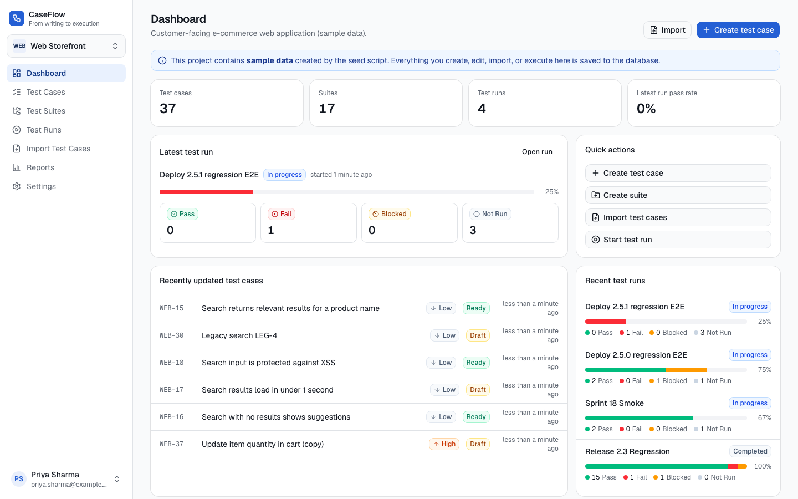

## Features

- **Projects** with a project switcher. Each project has its own case ID prefix (`WEB-12`). Data is scoped per project on every query.
- **Test cases**: create, edit, view, duplicate, archive/restore and delete (with confirmation). The list supports search by ID or title, filters (suite including sub-suites, priority, status, type, assignee, archived), sorting (ID, title, priority, updated), pagination, and bulk actions (move, set priority/status, archive, delete, start run).
- **Case form** with every field: title, project, nested suite, description, preconditions, a reorderable steps editor (action + expected result), priority, status, type, configurable severity, assignee, tags, estimate, automation status/reference, and attachments (stored on local disk). Created/updated metadata is recorded. Actions: Save, Save and add another, Save as draft, Cancel.
- **Suites**: a tree with case counts (including sub-suites). Create, rename, move (with cycle prevention) and delete. Deleting a suite that contains cases requires an explicit move-or-delete choice. Names are unique per parent.
- **Import wizard** (CSV and XLSX): upload, then preview (blank and malformed rows detected), then column mapping (legacy header aliases, manual mapping, unmapped columns need an explicit decision), then validation (missing and invalid values, unknown suites, step pairing, duplicates with skip/update/create per row, inline row correction, downloadable report), then confirmation (planned counts), then results. Imports run in one transaction and are idempotent per submission. Import history keeps per-row outcomes.
- **Regression runs**: create a run from all cases, selected suites, or specific cases, with environment, build/version, release/ticket, execution date, tester and notes. Case content is snapshotted per run. Results are Pass, Fail, Blocked or Not Run, with notes, a defect reference and multiple evidence links per execution. Recording again creates a new execution, and earlier executions and evidence are kept. Runs can be completed and reopened, and each deployment keeps its own run history.
- **Run report** with a summary, a per-case results table and evidence links. **CSV/XLSX export** includes stable run, run-case and execution IDs; the XLSX also has an "Execution history" sheet with every attempt.
- **Reports**: automation coverage, run history with pass rates, and breakdowns by priority, status, type, automation status and suite.
- **Demo mode**: there is no sign-in. The user menu picks the current user, who is recorded as creator, updater and executor.

## Project structure

```
prisma/                 schema.prisma, migrations/, seed.ts (sample data)
public/templates/       CSV import template
src/app/                routes (App Router)
  p/[code]/             project-scoped pages: dashboard, cases, suites, runs, import, reports, settings
  api/                  import parse/validate/commit, attachments, run export
src/components/         ui/ (shadcn), layout/, cases/, suites/, runs/, import/, common/
src/lib/                constants, Zod validation, import field mapping, step parser, suite tree, formatting
src/server/             services/ (business logic), actions/ (server actions), import/ (parse, validate, commit), context, storage
e2e/                    Playwright specs, helpers, fixtures (CSV/XLSX incl. legacy & malformed)
docs/screenshots/       screenshots captured by the e2e run
```

## Setup and run

Requires Node 20+ (tested on Node 22.13).

```bash
npm install                 # also runs prisma generate
cp .env.example .env        # DATABASE_URL="file:./dev.db"
npx prisma migrate deploy   # create/upgrade prisma/dev.db
npm run db:seed             # load SAMPLE data (wipes existing data in dev.db)
npm run dev                 # http://localhost:3000
```

Production: `npm run build && npm start`.

**Switching to PostgreSQL:** set `provider = "postgresql"` in `prisma/schema.prisma`, point `DATABASE_URL` at Postgres, and create a fresh migration. Enum-like columns are strings validated in the app, so no model changes are needed. Title search relies on SQLite's case-insensitive `LIKE`. On Postgres, add `mode: "insensitive"` in `src/server/services/test-cases.ts`.

## Quality commands (exactly as run)

```bash
npm run typecheck     # next typegen && tsc --noEmit
npm run lint          # eslint
npm run build         # next build
npm run test:e2e      # playwright test (builds the app and serves it on :3100 against prisma/e2e.db)
```

The e2e web server deletes and recreates `prisma/e2e.db` (migrate deploy + seed) before each run. It never touches `dev.db`. The HTML report is in `playwright-report/` (`npm run test:e2e:report`).

## QA checklist: test case form fields

Each field was exercised in the running app by `e2e/test-case-form.spec.ts`: entered through the UI, saved, checked in the database, reloaded, shown in the edit form, then edited in place (same record ID, no duplicate row).

| Field | Exists | Enter/select | Validation | Saves | Persists after reload | Shown when editing |
|---|---|---|---|---|---|---|
| Title | Yes | Yes | Yes (required, max 255) | Yes | Yes | Yes |
| Project | Yes | Yes | Yes (required; suites reload on change) | Yes | Yes | Yes |
| Suite (nested) | Yes | Yes | Yes (required, must belong to project) | Yes | Yes | Yes |
| Preconditions | Yes | Yes | Yes (max length) | Yes | Yes | Yes |
| Description | Yes | Yes | Yes (max length) | Yes | Yes | Yes |
| Steps (add/edit/remove/reorder) | Yes | Yes | Yes (action required when a step exists) | Yes (order kept) | Yes | Yes |
| Expected results (per step) | Yes | Yes | Yes (max length) | Yes | Yes | Yes |
| Priority | Yes | Yes | Yes (enum) | Yes | Yes | Yes |
| Status | Yes | Yes | Yes (enum; Save as draft forces Draft) | Yes | Yes | Yes |
| Type | Yes | Yes | Yes (enum) | Yes | Yes | Yes |
| Severity | Yes | Yes | Yes (must be a configured value; can be cleared) | Yes | Yes | Yes |
| Assignee | Yes | Yes | Yes (must exist; can be unassigned) | Yes | Yes | Yes |
| Tags | Yes | Yes | Yes (max 50 chars, 20 tags, de-duplicated) | Yes | Yes | Yes |
| Estimate | Yes | Yes | Yes (`30m`, `1h 30m`, minutes; "soon" rejected) | Yes | Yes | Yes |
| Automation status | Yes | Yes | Yes (enum) | Yes | Yes | Yes |
| Automation reference | Yes | Yes | Yes (max 500) | Yes | Yes | Yes |
| Attachments | Yes | Yes | Yes (10 MB limit) | Yes (file bytes verified on disk and via download) | Yes | Yes (listed, removable) |
| Test Case ID | Yes | Read-only | N/A | Auto-generated | Yes | Yes |
| Created/updated by & date | Yes | System | N/A | Yes | Yes | Yes |

## End-to-end results

**40 passed, 0 failed, 0 flaky** (Chromium, 1 worker, final run 57.7 s against a fresh production build). Every test also fails if the page logs a console error or throws an uncaught exception.

| Area (spec) | Scenarios covered | Result |
|---|---|---|
| Form (`test-case-form`) | field rendering and types; required/invalid validation; all fields save, persist, show on edit, edit in place; save and add another; save as draft; cancel; move to another project | 7/7 passed |
| List (`test-cases-list`) | search by title and ID; filter by suite/priority/status (counts match DB); sort and pagination; duplicate; delete with confirm/cancel; bulk move/priority/archive/restore | 6/6 passed |
| Suites (`suites`) | create suite and sub-suite in tree with counts; duplicate-name rejection; rename/move; delete requiring a move/delete choice | 3/3 passed |
| Import (`import`) | valid CSV (every field compared with DB); valid XLSX (multi-column steps, rich text, formulas); legacy headers, blank/malformed rows, unmapped columns, manual mapping, inline correction, validation report; missing/invalid values; same file twice (skip, then update, with per-row override); concurrent double submit is idempotent; unsupported .xls / fake .xlsx | 7/7 passed |
| Regression runs (`runs`) | run from a suite with deployment details; Pass/Fail/Blocked with defect and multiple evidence items; persists after reload; executions linked to the correct run and case; re-run creates a new execution and keeps earlier evidence; report and CSV/XLSX exports match the DB; complete/reopen locking; a new run doesn't overwrite the old; snapshot isolation; seeded evidence on report | 7/7 passed |
| UX (`ux`) | no horizontal scroll on 11 pages at 1440/834/390 px; mobile nav drawer; skip link, keyboard nav, visible focus, keyboard selects; every nav item and quick action works; project and user switching; buttons have accessible names; deleting an already-deleted case shows an error, not success; saving to a run completed elsewhere is rejected; integrations labelled "Not configured" | 9/9 passed |
| Screenshots (`zz-screenshots`) | captures `docs/screenshots/*` | 1/1 passed |

## Defects found during QA (all fixed and re-tested)

1. **Error toast covered the sticky Save button** (bottom-right), so the user couldn't retry. Found by the validation test. **Fixed:** toasts moved to top-right.
2. **Changing the sort kept the current page**, so page 2 of the new order looked wrong. **Fixed:** changing the sort resets to page 1.
3. **Import file chosen before hydration was silently lost** (no file shown). **Fixed:** the upload step picks up a pre-selected file on mount.
4. **Suites with the same name under different parents were indistinguishable** in selects for assistive tech ("Search" vs "Legacy > Search"). **Fixed:** options include a visually hidden ", in Parent" suffix.
5. **Run report scrolled horizontally on tablet/mobile** (up to 551 px). Absolutely positioned `sr-only` text inside a table escaped its scroll container. **Fixed:** scroll containers are positioned (`globals.css`). The responsive test now covers this page.
6. **Import preview listed suites to be created from invalid rows.** **Fixed:** only importable rows count.
7. Four React lint errors (state set inside effects) and one incompatible-library warning. **Fixed** without suppressions by deriving state, keyed remounts and `useWatch`.

No open defects are known in the implemented scope.

## Not implemented / limitations

- **Google Drive evidence upload: not implemented.** Evidence is entered as links. The `Evidence` model already has `provider`, `externalFileId` and `externalFolder` for a later Drive phase (OAuth, deployment folder, upload, store file ID and URL, private by default). Settings shows it as "Not configured". No upload buttons exist.
- **Google Sheets sync: not implemented.** CSV/XLSX export is available and carries stable run, run-case and execution IDs for a future idempotent sync.
- **E2E scenarios Blocked (need the integrations first):** failed Drive uploads, Drive permission errors, interrupted Sheets syncs.
- **No authentication.** Demo mode uses a user switcher. Server actions and routes don't check permissions.
- **`.xls` is not supported** (rejected with a clear message). CSV must be UTF-8.
- Attachments are stored on the local disk (`storage/attachments`). That's not suitable for multi-instance hosting without shared storage.
- Preconditions are plain multiline text, not rich text. Steps are reordered with up/down buttons (keyboard accessible), not drag and drop.
- Imports are capped at 5 MB / 5,000 rows and run in one transaction. Large-volume performance was not load-tested.
- Only Chromium was tested; Firefox and WebKit were not run.

## Progress checklist

- [x] Project scaffold, schema, migrations, seed
- [x] Test cases CRUD, list, filters, bulk actions, attachments
- [x] Suites tree and management
- [x] Import wizard (CSV/XLSX, mapping, validation, duplicates, history)
- [x] Test runs, execution, completion
- [x] Regression metadata, multi-evidence executions, run report, CSV/XLSX export
- [x] Reports, settings, projects
- [x] Typecheck, lint, build, 40 Playwright tests
- [ ] Google Drive evidence upload (planned)
- [ ] Google Sheets sync (planned)
- [ ] Authentication and permissions

## Screenshots

| | |
|---|---|
| 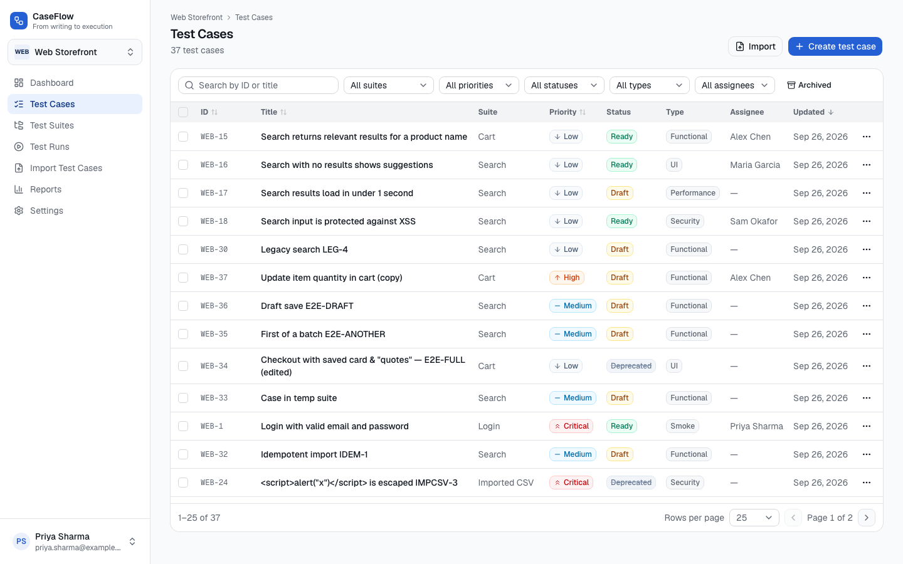 | 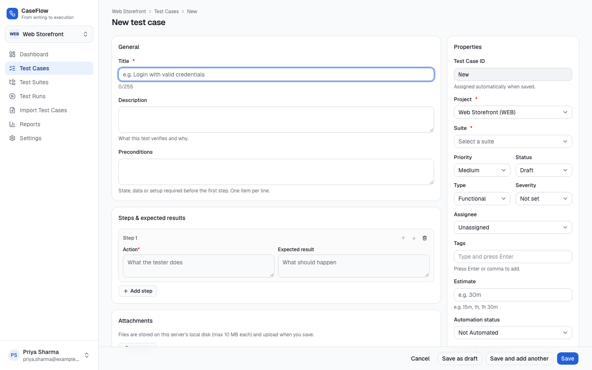 |
| 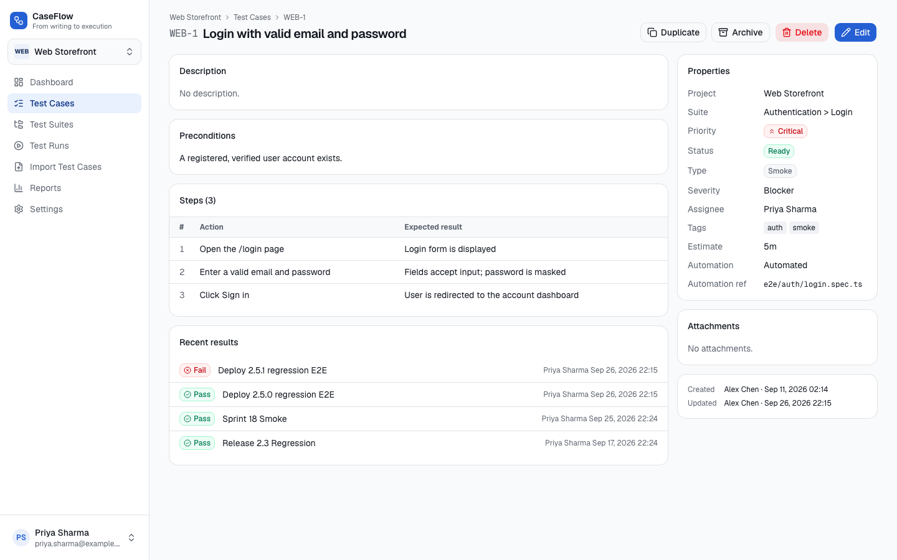 | 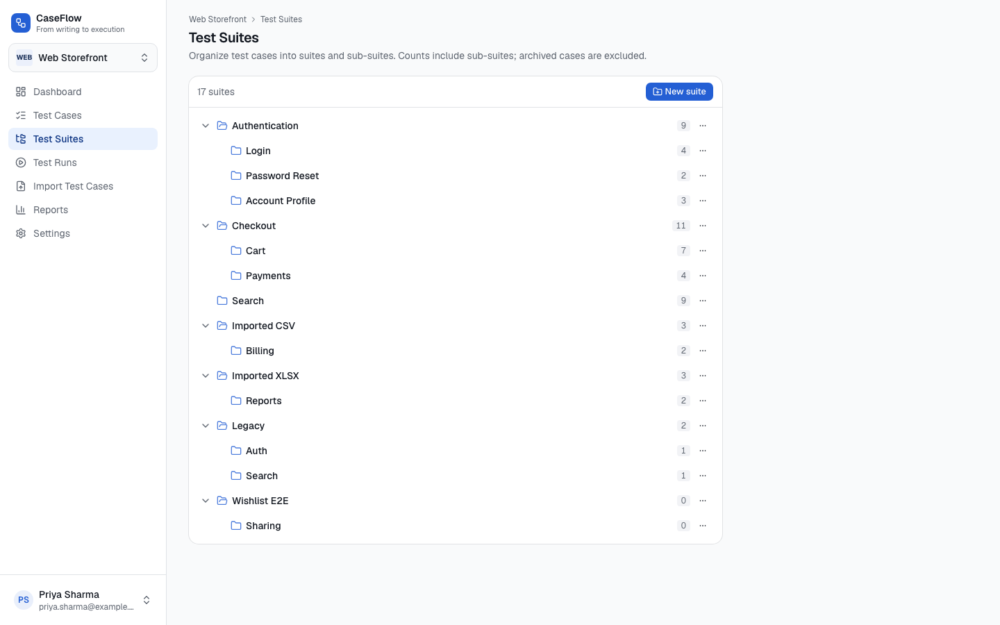 |
| 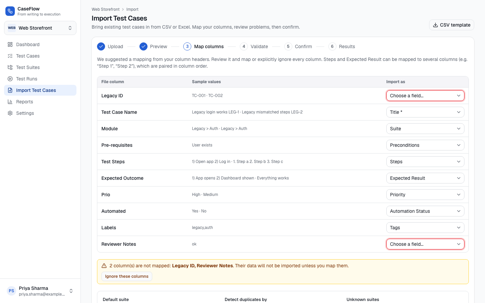 | 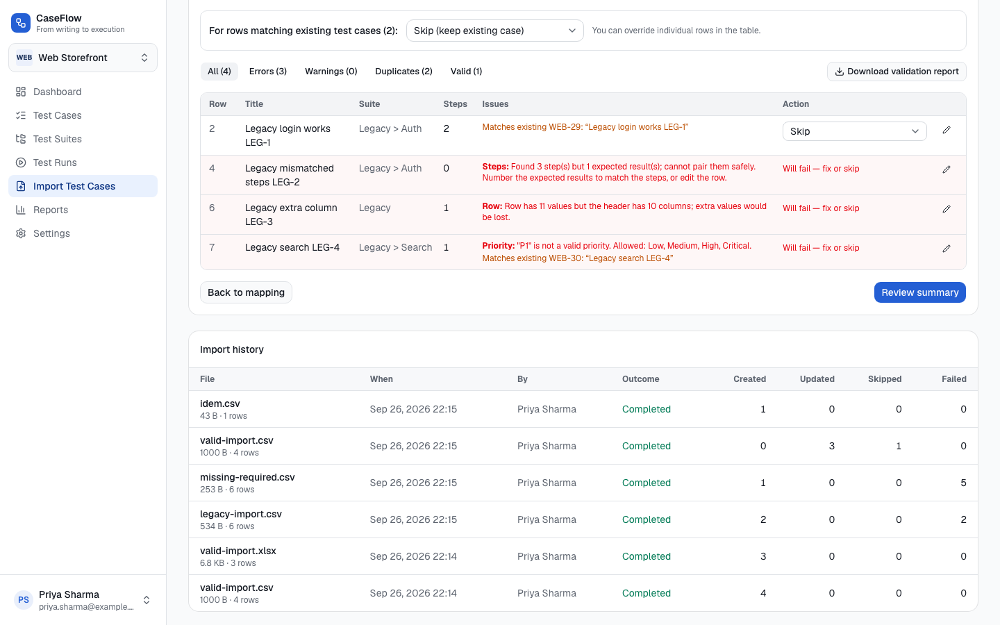 |
| 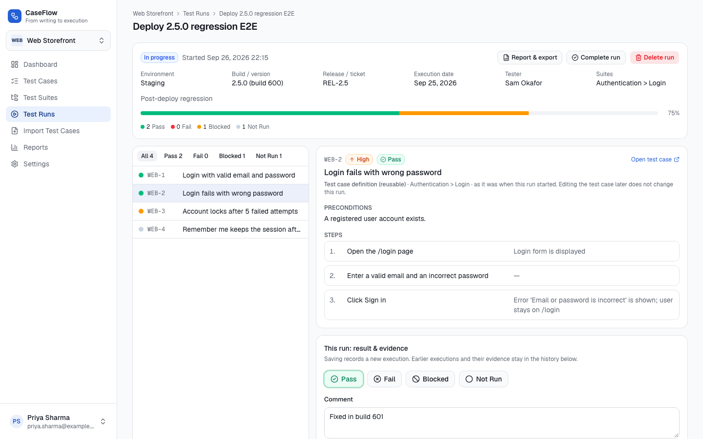 | 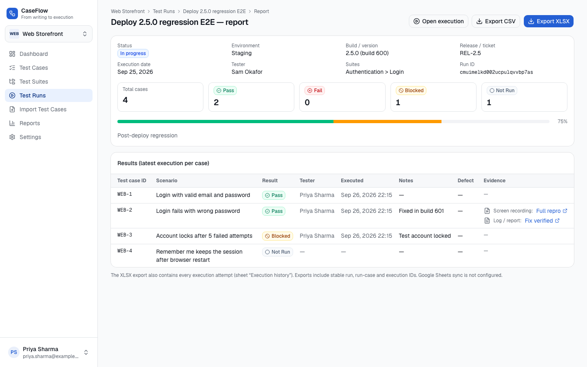 |
| 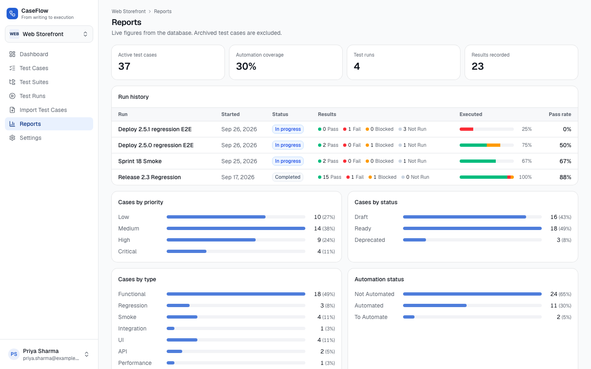 | 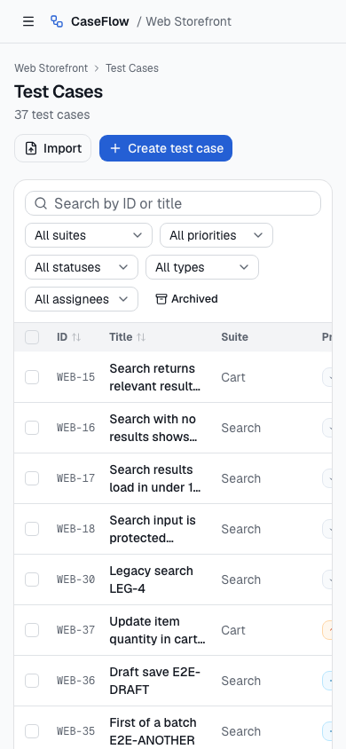 |
